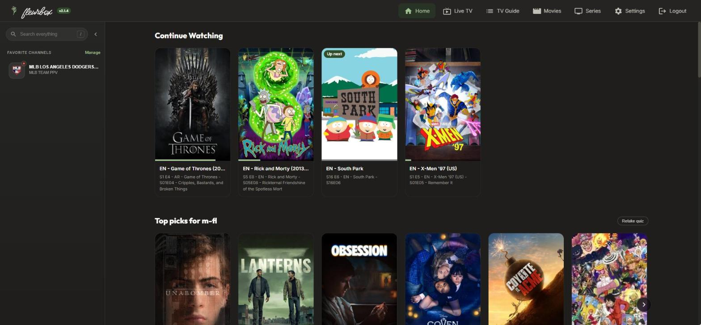
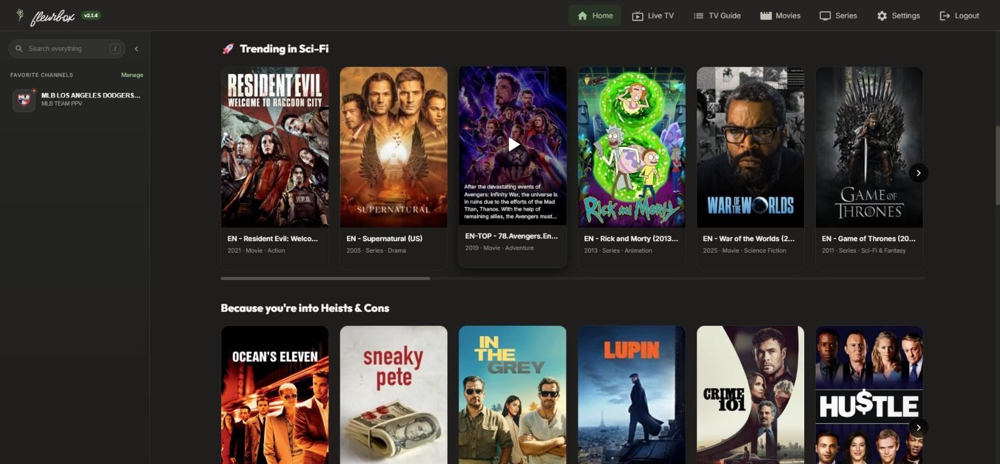
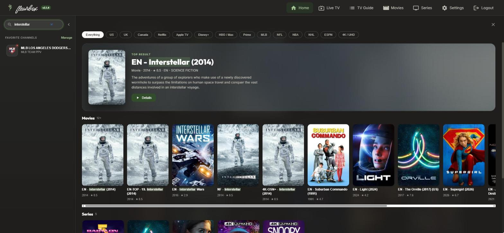
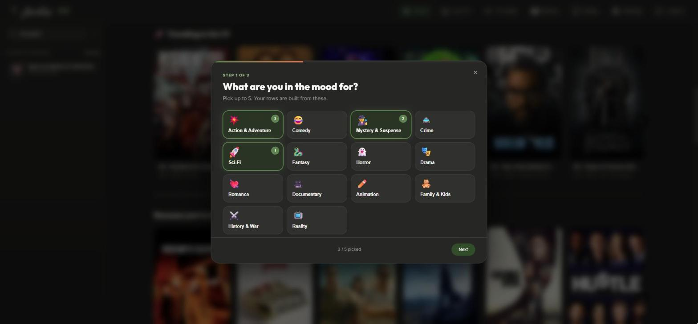
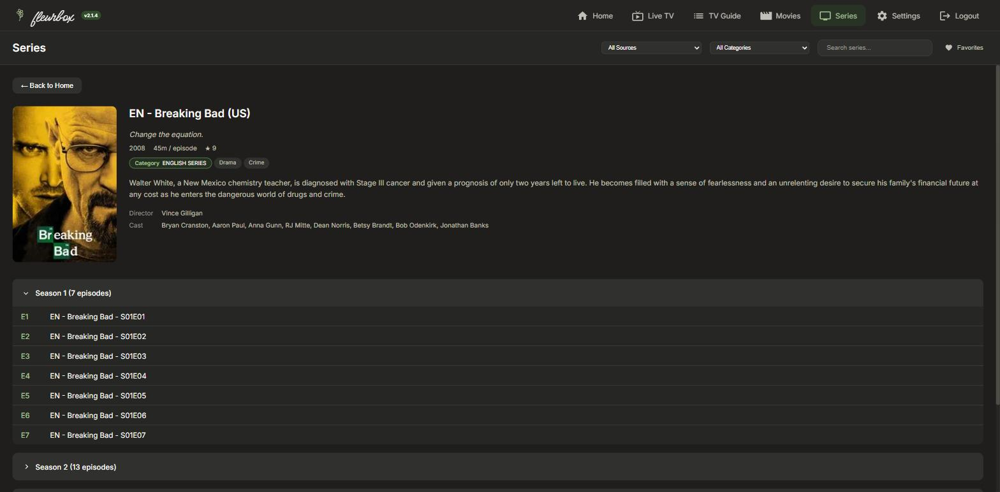
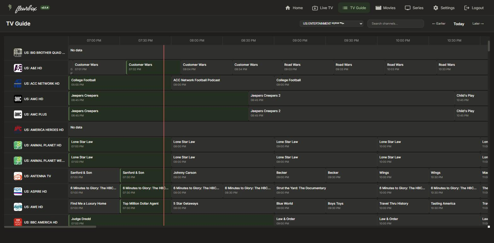
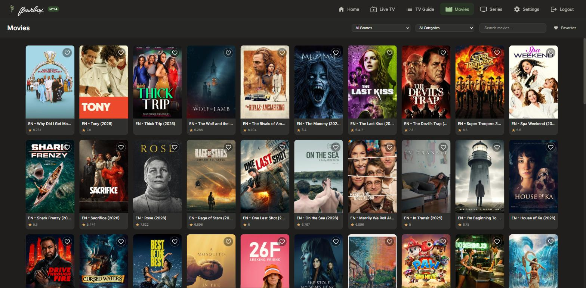

<p align="center">
  
</p>

<p align="center">
  <a href="LICENSE"></a>
  
  
  
</p>

**fleurbox** is a self-hosted, web-based IPTV player for Xtream Codes and M3U
providers. Live TV with a full guide, Movies and Series with rich details, and a
home screen that learns what you like. Run it on a home server and watch from any
browser, including phones.

<p align="center">
  
</p>

## Highlights

### Discover

- **Made-for-you rows.** A 30-second taste quiz (genres, favourite story themes,
  movies or series, era, popular or acclaimed) builds Netflix-style rows on Home:
  *Top picks for you*, *Trending in Sci-Fi*, *Because you're into Heists & Cons*,
  and so on. Each user has their own profile. Rankings follow TMDB's current
  popularity, matched to what is actually in your library.
- **Continue Watching.** Resume movies where you stopped. Finished an episode? The
  next one is waiting.
- **Trending this week.** TMDB's weekly trending movies and series, limited to
  titles you have.
- **Search everything.** One box in the sidebar searches titles, plots, cast,
  directors, genres and categories. Results open in a panel with a *Top result*
  spotlight, scrollable Movies and Series rows, and live channels. It also has a
  [query syntax](#search-syntax).
- **Filter zones.** One-tap shortcuts like Netflix, Disney+, Prime, 4K, NFL or ESPN,
  usable on their own or as a search scope.

### Watch

- **Live TV.** Fast channel zapping across thousands of channels, grouped and
  searchable, with what's on now.
- **TV Guide.** A 24-hour EPG grid with search and group filters.
- **Favourite channels** in the Home sidebar, showing the current programme and a
  progress bar.
- **Movies & Series.** Posters, plots, cast, director, genres and ratings from TMDB,
  plus season and episode lists.
- **A real player.** Audio track picker, subtitles, previous/next episode,
  autoplay with an *Up Next* countdown, and resume.
- **Language priority.** Titles in your language come first everywhere. You can
  optionally hide titles marked as another language.

### Under the hood

- **Smart playback.** Streams are probed and played directly, remuxed or
  transcoded only when the browser needs it.
- **Hardware transcoding** with NVIDIA NVENC, Intel QuickSync, AMD AMF and VAAPI,
  plus 5.1→stereo downmix presets.
- **Fast on huge playlists.** SQLite storage, an FTS5 full-text index and virtual
  scrolling handle 200k+ items and 50k+ channels.
- **Accounts.** Admin and viewer roles, plus SSO through any OIDC provider
  (Authentik, Keycloak, …).
- **Docker ready.** One container, data in one volume.

## Screenshots

<table>
  <tr>
    <td width="50%"><br><sub><b>For You:</b> rows built from your taste quiz</sub></td>
    <td width="50%"><br><sub><b>Search:</b> top result, rows, scopes</sub></td>
  </tr>
  <tr>
    <td><br><sub><b>Taste quiz:</b> three quick steps</sub></td>
    <td><br><sub><b>Series:</b> TMDB details and episodes</sub></td>
  </tr>
  <tr>
    <td><br><sub><b>TV Guide:</b> 24h EPG grid</sub></td>
    <td><br><sub><b>Movies:</b> your library at a glance</sub></td>
  </tr>
</table>

## Quick start (Docker)

```bash
git clone https://github.com/m-fl/fleurbox.git
cd fleurbox
cp .env.example .env        # then set JWT_SECRET (and TMDB_READ_TOKEN, recommended)
docker compose up -d --build
```

Open `http://<your-server>:3000`. On the first visit you create the **admin
account**. Then go to **Settings → Content Sources**, add your Xtream Codes or M3U
provider, and let the first sync finish. Large playlists take a few minutes.

### Configuration

All settings go in `.env` (see [`.env.example`](.env.example)):

| Variable | Required | What it does |
|---|---|---|
| `JWT_SECRET` | **Yes** | Signs login sessions. Use a long random string: `openssl rand -hex 32`. Without it a built-in default is used, so anyone could forge a session. |
| `TMDB_READ_TOKEN` | Recommended | TMDB *API Read Access Token* ([get one free](https://www.themoviedb.org/settings/api)). Enables plots, cast, genres, trending and the For You rows. |
| `PORT` | No | Port inside the container (default `3000`). |
| `OIDC_ISSUER_URL`, `OIDC_CLIENT_ID`, `OIDC_CLIENT_SECRET`, `OIDC_CALLBACK_URL` | No | Single sign-on, see [SSO / OIDC](#sso--oidc). |

Changes to `.env` need `docker compose up -d --force-recreate`.

### Running without Docker

Requires Node.js 18+ and FFmpeg on your `PATH`.

```bash
npm install
cp .env.example .env
npm run dev          # restarts on file changes
# or: npm start
```

### Developing in Docker

To edit code without rebuilding the image, add a `docker-compose.override.yml` that
bind-mounts the source. Then `docker compose restart` is enough after each change:

```yaml
services:
  fleurbox:
    volumes:
      - ./server:/app/server
      - ./public:/app/public
```

## Search syntax

| You type | It finds |
|---|---|
| `tom hanks` | every word must match; the last word can be partial |
| `"the dark knight"` | the exact phrase |
| `cast:"tom hanks"` `director:nolan` `genre:comedy` | a specific field (also `category:` `plot:` `title:` `tagline:`) |
| `genre:comedy OR genre:romance` | either one |
| `heist -horror` | exclude a word |
| `year:2007` `year:2007>` `year:2007<` `year:2000-2010` | release year: exact, from, until, range (also `date:`) |

Pick a scope chip (e.g. *Netflix*) in the search panel to search only within it.
Press `/` or `Ctrl/Cmd + K` to jump to search, `Esc` to close it.

## Hardware acceleration

Expose your GPU to the container, then check **Settings → Transcoding → Hardware
Detection**.

**Intel QuickSync / AMD (VAAPI)**

```yaml
services:
  fleurbox:
    devices:
      - /dev/dri:/dev/dri
    # group_add:          # only if needed for permissions
    #   - "video"
    #   - "render"
```

**NVIDIA (NVENC)**: install the [NVIDIA Container Toolkit](https://docs.nvidia.com/datacenter/cloud-native/container-toolkit/install-guide.html), then:

```yaml
services:
  fleurbox:
    deploy:
      resources:
        reservations:
          devices:
            - driver: nvidia
              count: 1
              capabilities: [gpu, utility, video, compute]
```

## SSO / OIDC

```env
OIDC_ISSUER_URL=https://your-idp.com/application/o/fleurbox/
OIDC_CLIENT_ID=your_client_id
OIDC_CLIENT_SECRET=your_client_secret
OIDC_CALLBACK_URL=https://tv.example.com/api/auth/oidc/callback
```

New SSO users start as **viewers**. An admin can promote them in Settings.

## Playback & codecs

Video is decoded by your browser. When it can't play a stream, fleurbox converts it
on the fly with FFmpeg.

| Codec | Chrome | Firefox | Safari | Edge |
|-------|--------|---------|--------|------|
| **H.264 (AVC)** | ✅ | ✅ | ✅ | ✅ |
| **H.265 (HEVC)** | Auto-transcode | Auto-transcode | ✅ | ⚠️ needs [HEVC extension](https://apps.microsoft.com/store/detail/hevc-video-extensions/9NMZLZ57R3T7) |
| **AV1** | ✅ | ✅ | Auto-transcode on older devices | ✅ |
| **AAC** | ✅ | ✅ | ✅ | ✅ |
| **AC3 / EAC3 (Dolby)** | Auto-transcode | Auto-transcode | ✅ | Auto-transcode |

**Stream types:** HLS (`.m3u8`) is recommended. MPEG-TS (`.ts`) works via remux.
RTMP/RTSP is not supported by browsers.

### Transcoding settings (Settings → Transcoding)

| Setting | Options / effect |
|---|---|
| **Hardware Encoder** | Auto, NVENC, AMF, QSV, VAAPI, Software |
| **Max Resolution** | 4K, 1080p, 720p, 480p (lower is faster) |
| **Quality Preset** | High, Medium, Low |
| **Audio Mix Preset** | Auto, ITU-R BS.775, Night Mode (clear dialogue), Cinematic, Passthrough |
| **Auto Transcode (Smart)** | Probe each stream and only remux/transcode when needed (default on) |
| **Force Audio Transcode** | Video passes through, audio becomes AAC. Use it when there's picture but no sound. |
| **Force Video Transcode** | Full transcode, for HEVC/VP9 on unsupported browsers |
| **Force Remux** | Raw `.ts` → MP4 without re-encoding |
| **Stream Output Format** | HLS or TS for Xtream requests (try TS if HLS buffers) |
| **Force Backend Proxy** | Route streams through the server (CORS problems, middleware) |

## Troubleshooting

| Symptom | Likely cause | Fix |
|---|---|---|
| Black screen, `Access-Control-Allow-Origin` error | CORS | Enable **Force Backend Proxy** |
| Black screen, `MEDIA_ERR_DECODE` | Unsupported codec | Keep **Auto Transcode** on |
| Loads forever, no error | Browser decoder stuck | Enable **Force Video Transcode** |
| Picture but no sound | Dolby/AC3 audio | Enable **Force Audio Transcode** |
| Constant buffering | Network or slow CPU/GPU | Lower **Max Resolution**, or switch to **TS** |
| Only English titles wanted | Mixed-language playlist | **Settings → Language Priority**, optionally *Hide titles in other languages* |
| No plots, cast or For You rows | No TMDB token | Set `TMDB_READ_TOKEN` and recreate the container |

### Behind a reverse proxy (HTTPS)

Plain-`http` streams and images are proxied automatically on HTTPS pages. Make sure
the proxy forwards `X-Forwarded-Proto` and doesn't buffer responses.

<details>
<summary>Caddy</summary>

```
tv.example.com {
    reverse_proxy fleurbox:3000 {
        flush_interval -1
        header_up X-Forwarded-Proto {scheme}
    }
}
```
</details>

<details>
<summary>Nginx</summary>

```nginx
location / {
    proxy_pass http://fleurbox:3000;
    proxy_http_version 1.1;
    proxy_buffering off;
    proxy_request_buffering off;
    proxy_read_timeout 300s;
    proxy_connect_timeout 60s;
    client_max_body_size 0;
    proxy_set_header Host $host;
    proxy_set_header X-Real-IP $remote_addr;
    proxy_set_header X-Forwarded-For $proxy_add_x_forwarded_for;
    proxy_set_header X-Forwarded-Proto $scheme;
    proxy_set_header Connection "";
}
```
</details>

<details>
<summary>Middleware (m3u-editor, Dispatcharr, Threadfin, xTeVe), TVHeadend, Acestream</summary>

- **Middleware:** enable **Force Backend Proxy** and keep **Auto Transcode** on.
  Raw MPEG-TS is detected and remuxed automatically.
- **TVHeadend:** enable **Force Backend Proxy**, or add your fleurbox URL (with
  `http://`/`https://`) to TVHeadend's *CORS origin*. Use *digest+plain* auth if
  the M3U URL carries credentials, and try `?profile=pass` if playback fails.
- **Acestream:** prefer the HLS output (`/ace/manifest.m3u8?id=…`) over
  `/ace/getstream` to save server CPU.
</details>

## How it's built

- **Backend:** Node.js + Express, SQLite via better-sqlite3 (FTS5 search index),
  FFmpeg for probe/remux/transcode
- **Frontend:** vanilla JavaScript (ES6+) and CSS, no framework, no build step;
  HLS.js for playback
- **Metadata:** TMDB, fetched politely in the background and stored locally, so
  nothing calls TMDB while a page loads

```
fleurbox/
├── public/                  # the whole frontend, served as-is
│   ├── index.html
│   ├── css/main.css
│   └── js/
│       ├── api.js           # API client
│       ├── components/      # ChannelList, EpgGuide, HomeSidebar, TasteQuiz, ...
│       └── pages/           # Home, Live, Guide, Movies, Series, Watch, Settings
└── server/
    ├── index.js             # entry point, auth gate, routes
    ├── auth.js              # JWT + passport (local, OIDC)
    ├── db.js, db/sqlite.js  # JSON settings store + SQLite content store
    ├── routes/              # proxy, transcode, search, home, details, live, ...
    └── services/            # sync, playlist/EPG parsers, search index, TMDB, taste
```

Runtime data (`data/`: SQLite database, settings, provider credentials) lives in
a volume and never goes in the image.

## Credits

fleurbox began as a fork of [nodecast-tv](https://github.com/technomancer702/nodecast-tv)
by technomancer702 and has since become its own project. Thank you to its authors
for the foundation.

 This product uses the TMDB API
but is not endorsed or certified by TMDB.

## License

[GPL-3.0](LICENSE). You may run, study, share and modify fleurbox. If you
distribute a modified version, it must also be GPL-3.0 and come with its source.
